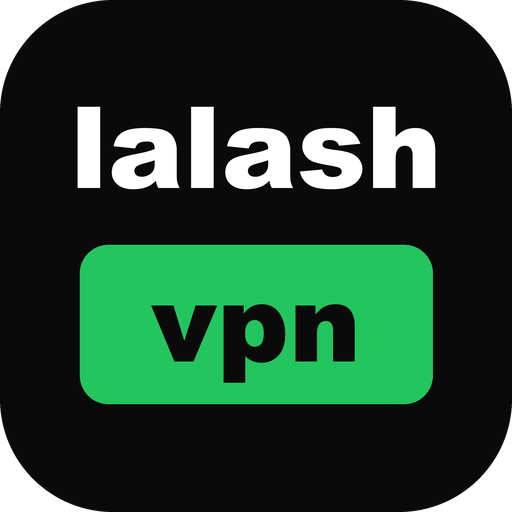
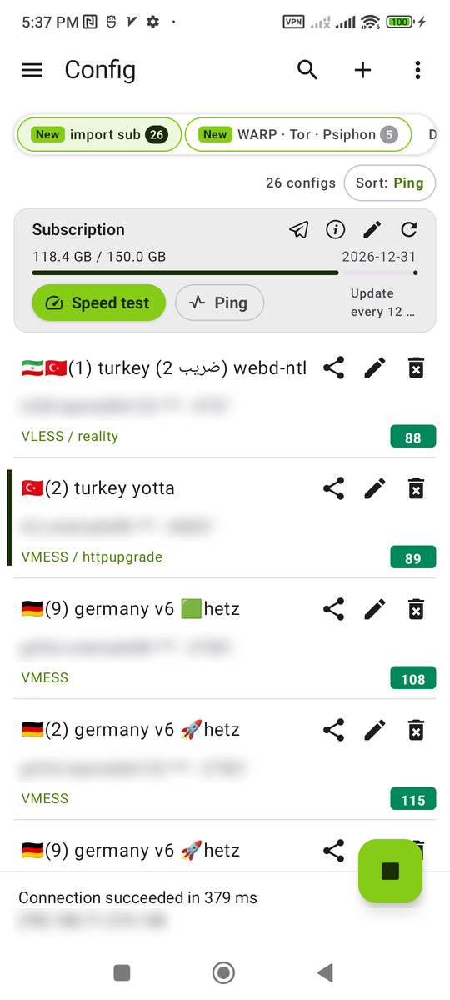
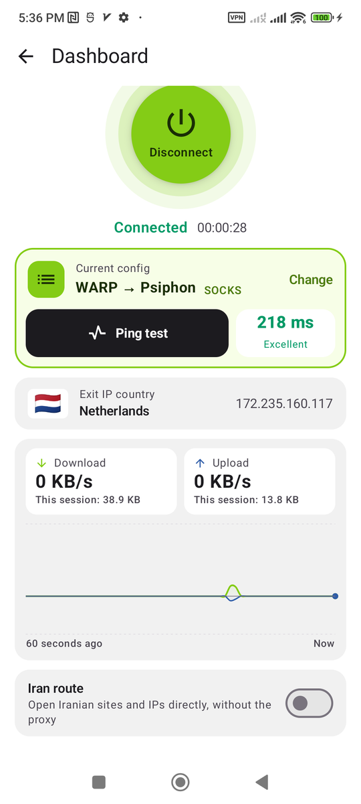
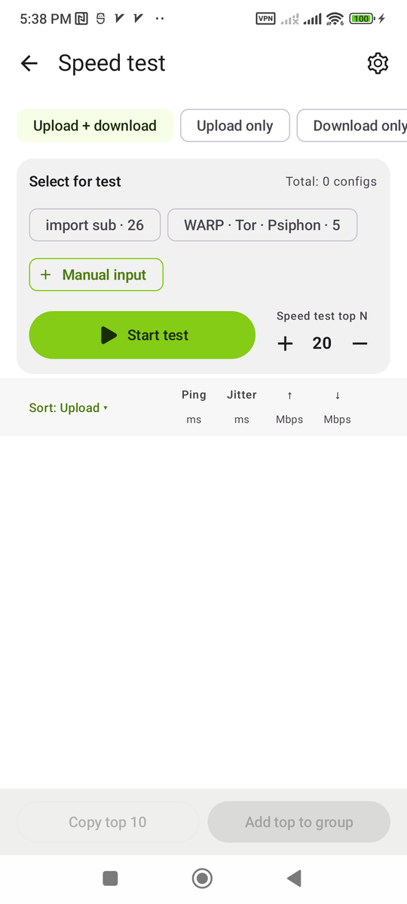
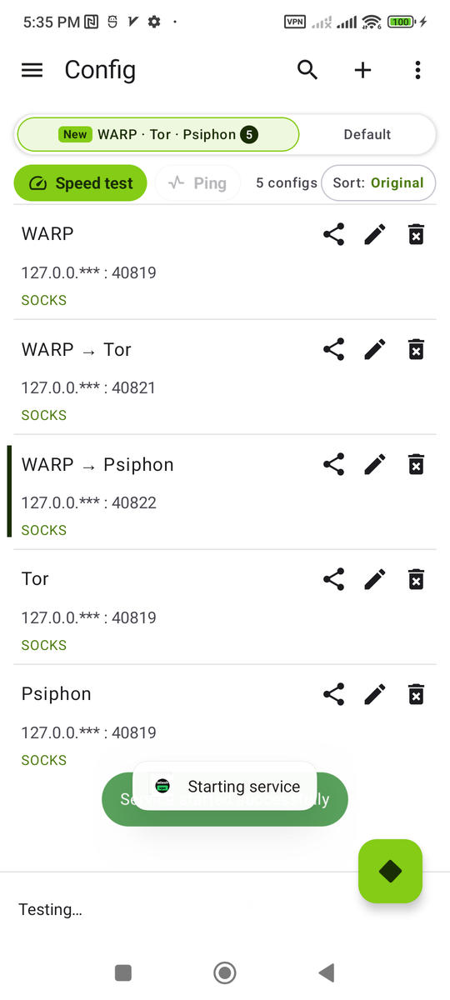
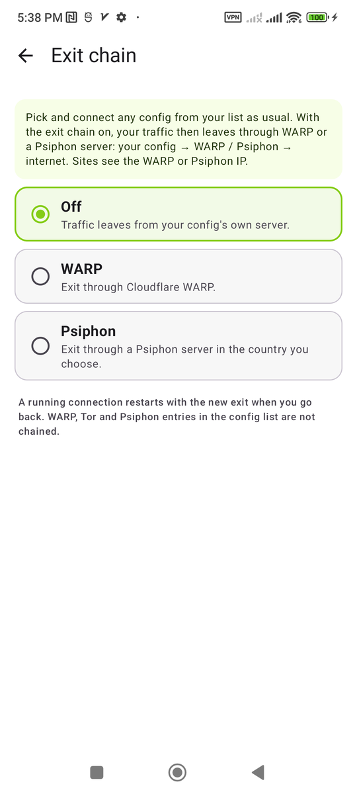
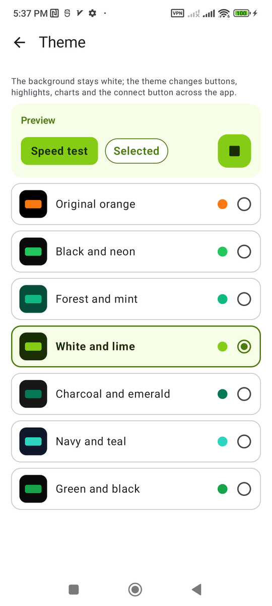

<p align="center">
  
</p>

<h1 align="center">lalash vpn</h1>

<p align="center">
  An Android VPN client built on <a href="https://github.com/XTLS/Xray-core">Xray core</a>, forked from <a href="https://github.com/2dust/v2rayNG">v2rayNG</a>.<br>
  Dashboard, usage statistics, config speed test, built-in WARP / Tor / Psiphon and an exit chain.
</p>

<p align="center">
  <a href="README_fa.md">فارسی</a> ·
  <a href="https://github.com/lalash/lalash-vpn/releases/latest">Download</a>
</p>

---

## Screenshots

| Config list | Dashboard | Speed test |
|---|---|---|
|  |  |  |

| WARP · Tor · Psiphon | Exit chain | Theme |
|---|---|---|
|  |  |  |

## Download

Get the APK from the [latest release](https://github.com/lalash/lalash-vpn/releases/latest). Pick the one that matches your phone's processor:

| File | For |
|---|---|
| `lalash-vpn_<version>_arm64-v8a.apk` | Almost every phone from the last 7 years. **Start here.** |
| `lalash-vpn_<version>_armeabi-v7a.apk` | Older or low-end phones with a 32-bit processor |
| `lalash-vpn_<version>_x86_64.apk` | Emulators, Chromebooks and Intel/AMD tablets |
| `lalash-vpn_<version>_x86.apk` | Old 32-bit emulators (no WARP / Tor / Psiphon) |
| `lalash-vpn_<version>_universal.apk` | Any device; larger download. Use it if you are not sure. |

Not sure which processor you have? Use the universal APK, or check with a free app such as *CPU-Z*.

### Install

1. Download the APK on your phone.
2. Open it. If Android asks, allow installing apps from this source (browser or file manager).
3. Tap **Install**, then open **lalash vpn**.

lalash vpn has its own package name (`com.lalash.vpn`), so it installs **next to** v2rayNG and does not replace it. Your v2rayNG configs are not moved over: export them from v2rayNG and import them here (subscription link, clipboard or QR code).

Requirements: Android 7.0 or newer. WARP, Tor, Psiphon and the exit chain need Android 10 or newer and an arm64, armeabi-v7a or x86_64 device.

## Features

Everything v2rayNG does (VMess, VLESS, Trojan, Shadowsocks, SOCKS, HTTP, Hysteria2, WireGuard, subscriptions, routing, per-app proxy, TUN mode), plus:

**Dashboard**
- Big connect button, the current config and a ping test that you can tap as many times as you like.
- Exit IP with the country flag.
- Live download / upload chart (follows the reading direction: left-to-right in English, right-to-left in Persian) with speeds in KB/s or MB/s.
- *Iran route* switch: Iranian sites and IPs go direct, everything else through the proxy.

**Usage statistics**
- Total traffic and traffic per config.

**Config speed test**
- Phase 1 measures ping and jitter of every config at once; phase 2 measures download and upload only for the best N.
- Choose how many of the best configs go to phase 2. Own settings page: test duration, parallel streams, ping probes and concurrency, ping address (including the app's own test URL).
- Pick subscriptions to test or paste configs by hand; copy the best ones or add them to a group.

**Config list**
- Ping shown as a coloured box (green under 300 ms, yellow above, red × for no answer) with the last download / upload speed next to it.
- Sort by subscription order, ping, jitter, download, upload or name.
- Subscription card: usage, expiry, edit (name, URL, auto update every N hours, auto ping every N minutes), speed test and ping for the whole group.
- New subscriptions go first with a "new" mark and are fetched with up to 5 retries.
- New subscriptions update every 12 hours and auto-ping every 2 minutes, only while the app is open on them (no battery or data use in the background).
- "Tap to check connection" can be tapped repeatedly; every result is shown.

**WARP · Tor · Psiphon (no config needed)**
- Five ready entries: WARP, WARP → Tor, WARP → Psiphon, Tor, Psiphon.
- Choose the Psiphon exit country.
- Automatic WARP protocol choice (WireGuard, MASQUE, …) and endpoint scan.

**Exit chain**
- Connect with any of your configs as usual and leave the internet through WARP or a Psiphon server in the country you choose: *your config → WARP / Psiphon → internet*.
- A small notice on the config list and dashboard shows when the chain is on.

**Themes**
- The original orange or six green themes; the whole app follows the choice and the background stays white.

**Languages**: English and Persian (plus the languages v2rayNG ships).

## Build from source

```bash
git clone --recursive https://github.com/lalash/lalash-vpn.git
cd lalash-vpn
```

Native parts are not stored in git (`V2rayNG/app/libs` is ignored). Put them in place first:

1. **Xray core** – `V2rayNG/app/libs/libv2ray.aar`, built from [AndroidLibXrayLite](https://github.com/2dust/AndroidLibXrayLite) (see `.github/workflows/build.yml`) or taken from its releases.
2. **Tunnel** – run `compile-hevtun.sh` with `NDK_HOME` set, then copy `libs/<abi>/*.so` to `V2rayNG/app/libs/<abi>/`.
3. **WARP / Tor / Psiphon engine** – download `aether-android-{arm64,armv7,x86_64}.tar.gz` from [CluvexStudio/Aether v2.4.0](https://github.com/CluvexStudio/Aether/releases/tag/v2.4.0) and copy, per ABI:
   - `aether` → `libaether.so`
   - `pt/psiphon-tunnel-core` → `libpsiphon.so`
   - `pt/lyrebird` → `libpt-lyrebird.so`

   (`arm64` → `arm64-v8a`, `armv7` → `armeabi-v7a`, `x86_64` → `x86_64`.)

Then, with JDK 17 and the Android SDK:

```bash
cd V2rayNG
./gradlew :app:assemblePlaystoreDebug          # debug, all ABIs
./gradlew :app:assemblePlaystoreRelease -PLALASH_SIGNING=/path/keystore.properties
```

`keystore.properties` holds `storeFile`, `storePassword`, `keyAlias` and `keyPassword`. Without it the release APKs are unsigned.

## Credits and licences

- [v2rayNG](https://github.com/2dust/v2rayNG) by 2dust – the app this is forked from (GPL-3.0).
- [Xray-core](https://github.com/XTLS/Xray-core) (MPL-2.0) via [AndroidLibXrayLite](https://github.com/2dust/AndroidLibXrayLite).
- [hev-socks5-tunnel](https://github.com/heiher/hev-socks5-tunnel) (MIT).
- WARP / Tor / Psiphon engine: [Aether](https://github.com/CluvexStudio/Aether) (AGPL-3.0), shipped unmodified as a separate program, with [psiphon-tunnel-core](https://github.com/Psiphon-Labs/psiphon-tunnel-core) (GPL-3.0) and [lyrebird](https://gitlab.torproject.org/tpo/anti-censorship/pluggable-transports/lyrebird) (BSD-2-Clause / GPL-3.0). Their licences are in `V2rayNG/app/src/main/assets/`.

lalash vpn is licensed under the [GPL-3.0](LICENSE), like v2rayNG. It is an independent fork and is not affiliated with or endorsed by the v2rayNG, Xray, Aether, Cloudflare, Tor or Psiphon projects.
