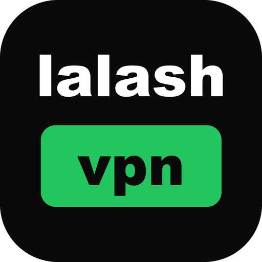
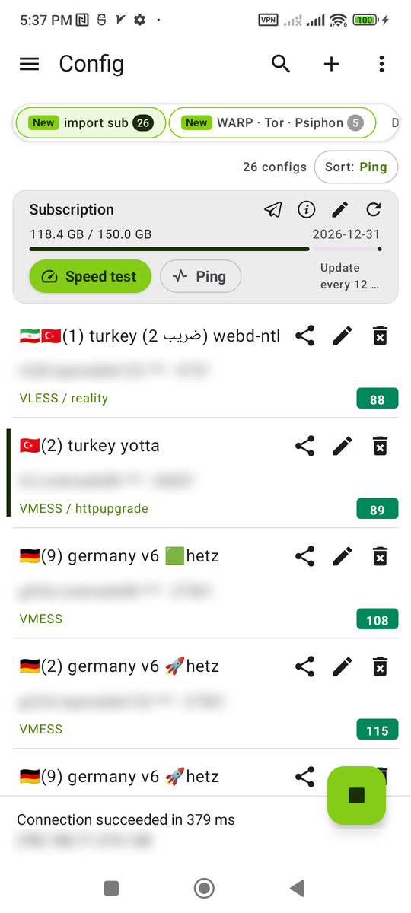
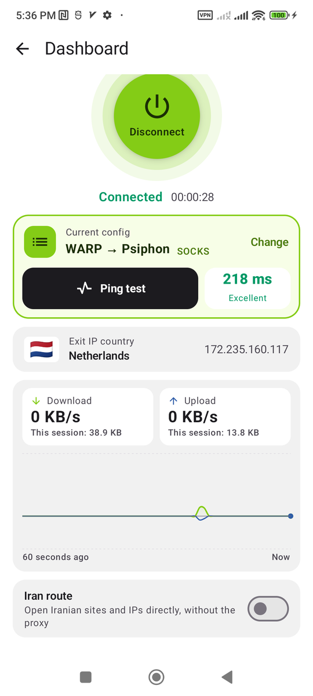
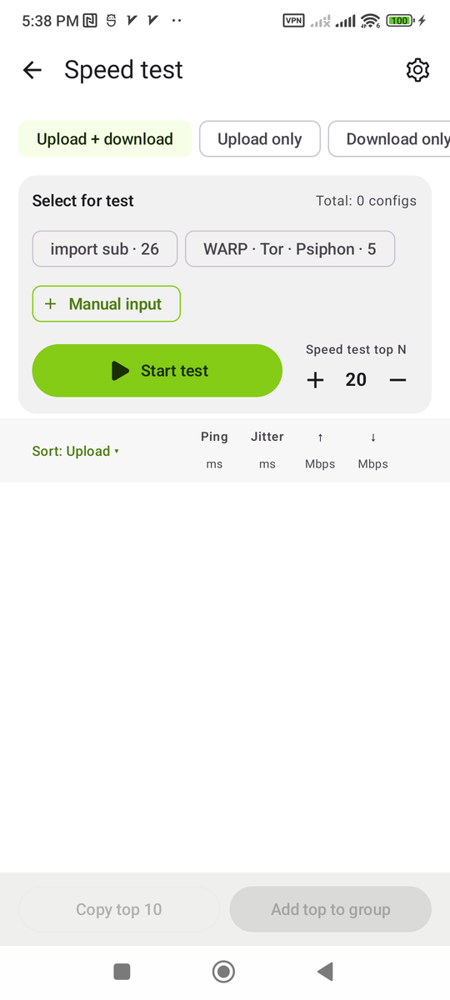
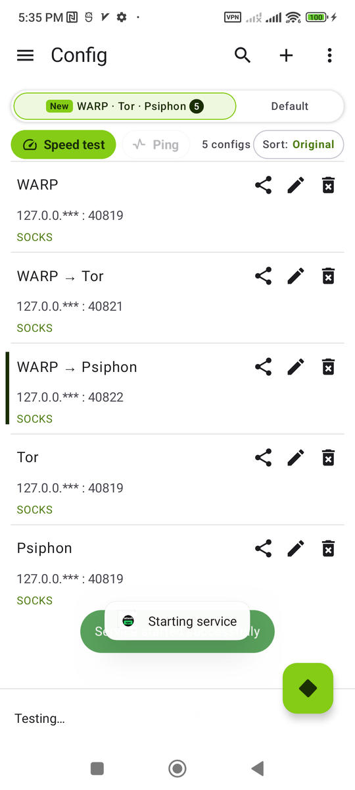
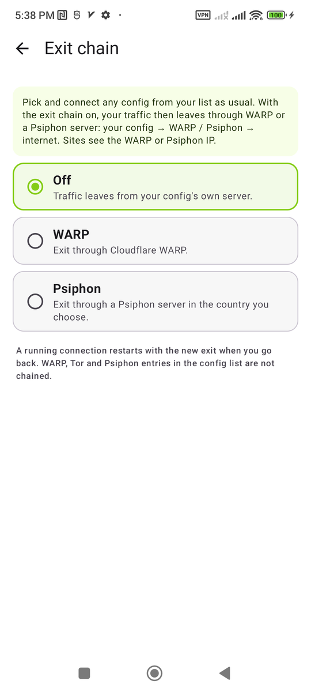
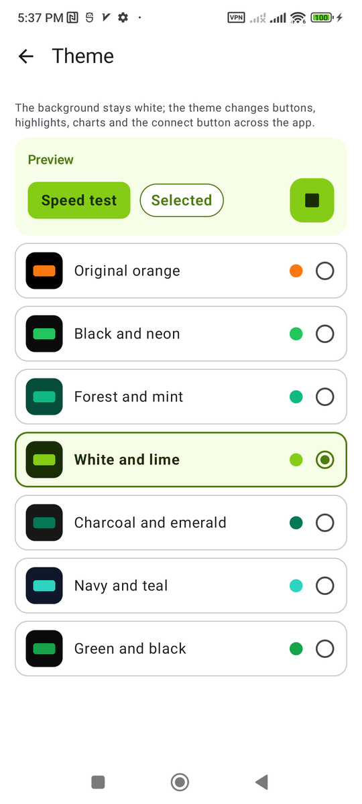

  

<h1 align="center">lalash vpn</h1>

  کلاینت VPN اندروید بر پایه‌ی <a href="https://github.com/XTLS/Xray-core">هسته Xray</a>، فورک‌شده از <a href="https://github.com/2dust/v2rayNG">v2rayNG</a>. 
  داشبورد، آمار مصرف، تست سرعت کانفیگ‌ها، WARP / Tor / سایفون داخلی و زنجیره خروجی.

  <a href="README.md">English</a> ·
  <a href="https://github.com/lalash/lalash-vpn/releases/latest">دانلود</a>

---

## تصاویر برنامه

| لیست کانفیگ‌ها | داشبورد | تست سرعت |
|---|---|---|
|  |  |  |

| WARP · Tor · سایفون | زنجیره خروجی | تم برنامه |
|---|---|---|
|  |  |  |

## دانلود

فایل APK را از [آخرین نسخه](https://github.com/lalash/lalash-vpn/releases/latest) دانلود کنید. فایلی را بردارید که با پردازنده‌ی گوشی‌تان جور است:

| فایل | مناسب برای |
|---|---|
| `lalash-vpn_<نسخه>_arm64-v8a.apk` | تقریباً همه‌ی گوشی‌های ۷ سال اخیر. **اول این را امتحان کنید.** |
| `lalash-vpn_<نسخه>_armeabi-v7a.apk` | گوشی‌های قدیمی یا ارزان با پردازنده‌ی ۳۲ بیتی |
| `lalash-vpn_<نسخه>_x86_64.apk` | شبیه‌سازها، کروم‌بوک‌ها و تبلت‌های اینتل/AMD |
| `lalash-vpn_<نسخه>_x86.apk` | شبیه‌سازهای قدیمی ۳۲ بیتی (بدون WARP / Tor / سایفون) |
| `lalash-vpn_<نسخه>_universal.apk` | همه‌ی دستگاه‌ها؛ حجمش بیشتر است. اگر مطمئن نیستید این را بگیرید. |

اگر نمی‌دانید پردازنده‌ی گوشی‌تان چیست، نسخه‌ی universal را نصب کنید یا با برنامه‌ای مثل *CPU-Z* نگاه کنید.

### نصب

۱. فایل APK را روی گوشی دانلود کنید.
۲. بازش کنید. اگر اندروید پرسید، اجازه‌ی نصب از این منبع (مرورگر یا فایل‌منیجر) را بدهید.
۳. **نصب** را بزنید و بعد **lalash vpn** را باز کنید.

lalash vpn نام بسته‌ی جداگانه‌ی خودش (`com.lalash.vpn`) را دارد، پس **کنار** v2rayNG نصب می‌شود و جای آن را نمی‌گیرد. کانفیگ‌های v2rayNG خودکار منتقل نمی‌شوند: از v2rayNG خروجی بگیرید و اینجا وارد کنید (لینک اشتراک، کلیپ‌بورد یا QR کد).

پیش‌نیاز: اندروید ۷ یا بالاتر. WARP، Tor، سایفون و زنجیره خروجی به اندروید ۱۰ یا بالاتر و پردازنده‌ی arm64، armeabi-v7a یا x86_64 نیاز دارند.

## امکانات

همه‌ی امکانات v2rayNG (VMess، VLESS، Trojan، Shadowsocks، SOCKS، HTTP، Hysteria2، WireGuard، اشتراک‌ها، مسیریابی، پروکسی برای هر برنامه، حالت TUN)، به‌علاوه‌ی:

**داشبورد**
- دکمه‌ی بزرگ اتصال، کانفیگ فعلی و تست پینگ که هر چند بار بخواهید می‌توانید بزنید.
- IP خروجی با پرچم کشور.
- نمودار زنده‌ی دانلود و آپلود (هم‌جهت با زبان: در فارسی از راست به چپ، در انگلیسی از چپ به راست) با سرعت به کیلوبایت یا مگابایت بر ثانیه.
- کلید *مسیر ایران*: سایت‌ها و IPهای ایرانی مستقیم، بقیه از پروکسی.

**آمار مصرف**
- مصرف کل و مصرف هر کانفیگ.

**تست سرعت کانفیگ‌ها**
- مرحله‌ی اول پینگ و جیتر همه‌ی کانفیگ‌ها را هم‌زمان می‌گیرد؛ مرحله‌ی دوم فقط برای N تای برتر دانلود و آپلود را می‌سنجد.
- تعداد کانفیگ‌های برتر برای مرحله‌ی دوم قابل انتخاب است. صفحه‌ی تنظیمات جدا: مدت تست، تعداد اتصال‌های هم‌زمان، تعداد نمونه‌ی پینگ و هم‌زمانی، آدرس تست پینگ (از جمله آدرس خود برنامه).
- انتخاب اشتراک‌ها برای تست یا وارد کردن دستی کانفیگ‌ها؛ کپی بهترین‌ها یا افزودنشان به یک گروه.

**لیست کانفیگ‌ها**
- پینگ به شکل عدد در کادر رنگی (سبز زیر ۳۰۰، زرد بالای ۳۰۰، قرمز × یعنی بدون پاسخ) و آخرین سرعت دانلود و آپلود کنارش.
- مرتب‌سازی بر اساس ترتیب اشتراک، پینگ، جیتر، دانلود، آپلود یا نام.
- کارت اشتراک: حجم مصرفی، تاریخ انقضا، ویرایش (نام، لینک، به‌روزرسانی خودکار هر N ساعت، پینگ خودکار هر N دقیقه)، تست سرعت و پینگ کل گروه.
- اشتراک جدید اول لیست با علامت «جدید» می‌آید و تا ۵ بار برای گرفتن کانفیگ‌ها تلاش می‌کند.
- اشتراک‌های جدید هر ۱۲ ساعت به‌روز می‌شوند و هر ۲ دقیقه پینگ خودکار می‌گیرند، فقط وقتی برنامه روی آن اشتراک باز است (بدون مصرف باتری و اینترنت در پس‌زمینه).
- «Tap to check connection» را می‌توانید پشت سر هم بزنید و نتیجه‌ی همه نشان داده می‌شود.

**WARP · Tor · سایفون (بدون نیاز به کانفیگ)**
- پنج ورودی آماده: WARP، WARP ← Tor، WARP ← سایفون، Tor، سایفون.
- انتخاب کشور IP خروجی سایفون.
- انتخاب خودکار پروتکل WARP (WireGuard، MASQUE و …) و جست‌وجوی آدرس سالم.

**زنجیره خروجی**
- با هر کانفیگ خودتان مثل همیشه وصل شوید و از WARP یا سرور سایفون در کشور دلخواه خارج شوید: *کانفیگ شما ← WARP / سایفون ← اینترنت*.
- وقتی زنجیره روشن است، یک نوشته‌ی کوچک روی لیست کانفیگ‌ها و داشبورد نشانش می‌دهد.

**بررسی شبکه**
- اینترنت خود گوشی را بررسی می‌کند (نه VPN را): مودم، DNS، سایت‌ها و DNSهای ایرانی (شکن، الکترو، رادار گیم، بگذار، 403.online)، سایت‌های خارجی و DNSهای بین‌المللی.
- برای هر کدام پینگ و زمان جواب یا دلیل کار نکردن (مسدود با DNS، بی‌جواب، رد شدن، فیلتر SNI) را نشان می‌دهد و در آخر نتیجه می‌گیرد: شبکه وصل نیست، مودم، اصلاً اینترنت ندارید، DNS گوشی، قطعی بین‌الملل، فیلترینگ معمول یا همه‌چیز سالم.

**کیل سوییچ**
- وقتی اتصال قطع شود، برنامه‌ها مسدود می‌مانند و برنامه خودش دوباره وصل می‌شود (در صورت نیاز با بهترین کانفیگ بعدی).
- دکمه‌ی رفتن به «VPN همیشه روشن» و «مسدود کردن اتصال‌های بدون VPN» اندروید برای محافظت کامل.

**تم‌ها**
- نارنجی اصلی یا شش تم سبز؛ کل برنامه رنگ تم را می‌گیرد و پس‌زمینه سفید می‌ماند.

**زبان‌ها**: فارسی و انگلیسی (به‌علاوه‌ی زبان‌هایی که v2rayNG دارد).

## ساخت از سورس

راهنمای کامل ساخت در [README انگلیسی](README.md#build-from-source) است. خلاصه:

۱. مخزن را با `git clone --recursive` بگیرید.
۲. فایل `libv2ray.aar`، کتابخانه‌های تونل (`compile-hevtun.sh`) و فایل‌های موتور WARP/Tor/سایفون (از [Aether v2.4.0](https://github.com/CluvexStudio/Aether/releases/tag/v2.4.0)) را در `V2rayNG/app/libs/<abi>/` بگذارید.
۳. با JDK 17 دستور `./gradlew :app:assemblePlaystoreRelease` را اجرا کنید.

## سپاس و مجوزها

- [v2rayNG](https://github.com/2dust/v2rayNG) از 2dust – برنامه‌ای که این پروژه از آن فورک شده (GPL-3.0).
- [Xray-core](https://github.com/XTLS/Xray-core) (MPL-2.0) از طریق [AndroidLibXrayLite](https://github.com/2dust/AndroidLibXrayLite).
- [hev-socks5-tunnel](https://github.com/heiher/hev-socks5-tunnel) (MIT).
- موتور WARP / Tor / سایفون: [Aether](https://github.com/CluvexStudio/Aether) (AGPL-3.0) که بدون تغییر و به‌صورت برنامه‌ی جدا همراه برنامه است، به‌همراه [psiphon-tunnel-core](https://github.com/Psiphon-Labs/psiphon-tunnel-core) (GPL-3.0) و [lyrebird](https://gitlab.torproject.org/tpo/anti-censorship/pluggable-transports/lyrebird). متن مجوزهایشان در `V2rayNG/app/src/main/assets/` است.

lalash vpn مثل v2rayNG تحت مجوز [GPL-3.0](LICENSE) منتشر می‌شود. این یک فورک مستقل است و با پروژه‌های v2rayNG، Xray، Aether، Cloudflare، Tor یا سایفون ارتباط رسمی ندارد.

